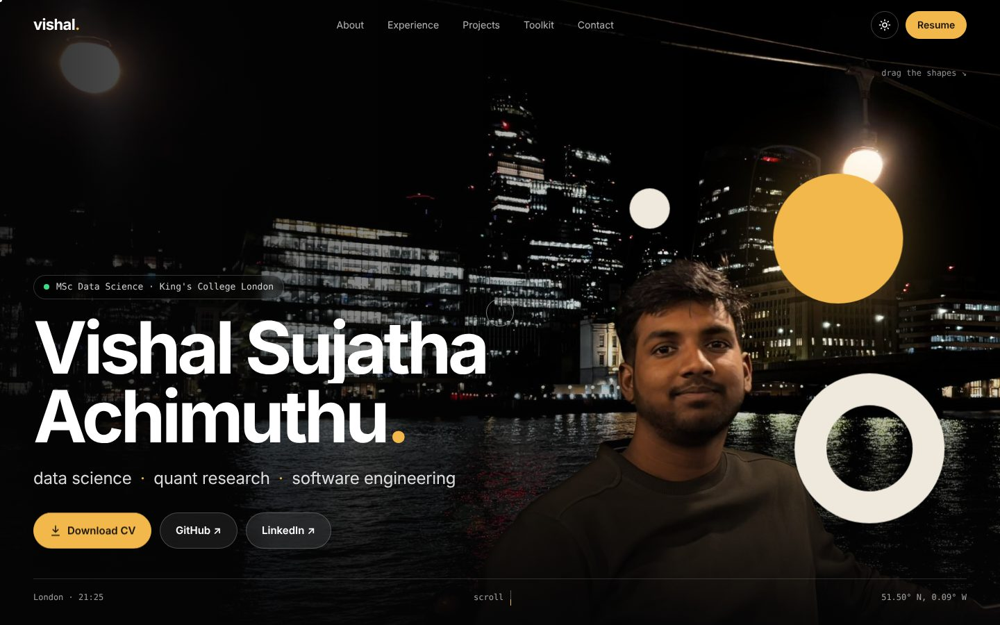

# saindustries.github.io

My personal site: who I am, what I've worked on, and how to reach me.

**Live:** [saindustries.github.io](https://saindustries.github.io)



## About

I'm Vishal, an MSc Data Science student at King's College London. Before this I spent a year and a half as a software engineer at LTM (formerly LTI Mindtree), building AI features for hospitality, logistics and airline clients. These days most of my time goes into quantitative research: market microstructure, backtesting, and checking whether a signal still holds up out of sample.

I wanted one place that shows that work properly, instead of a CV squeezing it into bullet points. So I built this from scratch, with no templates and no site builders.

## What's on it

- **Projects.** The work I'm proudest of, led by [LOB Market Making](https://github.com/SAIndustries/LOB-Market-Making) and [Quant-Signal-Lab](https://github.com/SAIndustries/quant-signal-lab).
- **Repository index.** Pulled live from the GitHub API, so anything new I push shows up without me touching the site.
- **Experience and education.** LTM, Ripen Labs, King's and Panimalar.
- **Contact form.** Messages come straight to my inbox.
- **Chennai to London.** Where I'm from and where I am now, with both local times.

## How it's built

Plain HTML, CSS and JavaScript. There's no framework and no build step; GitHub Pages serves the files as they are.

The motion is where most of the effort went:

- **Smooth scrolling** with [Lenis](https://github.com/darkroomengineering/lenis), and scroll-driven animation with [GSAP](https://gsap.com) and ScrollTrigger.
- **The shapes on the landing screen** run on a small physics loop I wrote: spring forces, collisions, and a repulsion zone so they never cover my face, whatever the screen size.
- **A pinned horizontal scroll** for projects, a draggable skills orbit, and a marquee that reacts to how fast you scroll.
- **A custom cursor, magnetic buttons, and text that reveals word by word.**

It also had to stay usable, not just look good:

- **Reduced motion.** If your system asks for it, every animation switches off and the page reads as a normal static site.
- **Phones.** The layout is designed for small screens on its own terms, not as a shrunken desktop.
- **Accessibility.** The page uses semantic HTML, works with the keyboard, and keeps text readable in both themes.
- **Light and dark themes**, with the same warm amber accent in both.

Libraries are bundled locally in `assets/js`, so the site doesn't depend on a CDN being up.

## Running it locally

```bash
git clone https://github.com/SAIndustries/SAIndustries.github.io.git
cd SAIndustries.github.io
python3 -m http.server
```

Then open http://localhost:8000.

## Structure

```
index.html     content
styles.css     design tokens, layout, responsive rules
script.js      animation, physics, GitHub sync, contact form
assets/        photos, CV, favicon, vendored JS libraries
```

## Credits

- **Animation:** [GSAP](https://gsap.com) and [Lenis](https://github.com/darkroomengineering/lenis).
- **Contact form delivery:** [FormSubmit](https://formsubmit.co).
- **Type:** Space Grotesk, Inter, Instrument Serif and JetBrains Mono, all via Google Fonts.
- **Design inspiration:** motion-led studio sites like [gravity-design.de](https://gravity-design.de).

## Contact

If you'd like to talk about quant, data science or anything else on here, the form on the site is the quickest route. You can also reach me on [LinkedIn](https://www.linkedin.com/in/saindustries/).

---

© 2026 Vishal Sujatha Achimuthu. The code is free to learn from. Please don't reuse the content or photos as your own.
